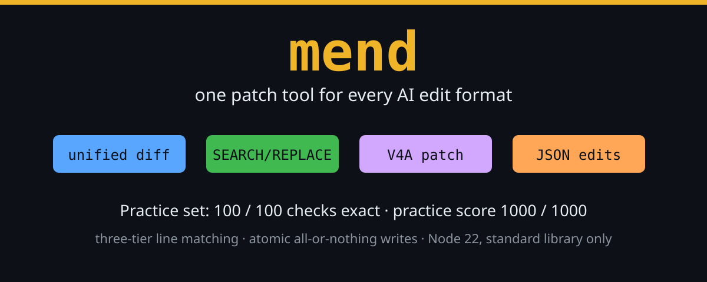

# makefun-mend-20261123

[](https://make.fun/bounty/hidden-spec-cli-01-run-20261122?utm_source=github&utm_medium=readme&utm_campaign=hidden-spec-cli-01-run-20261122)
[](https://make.fun/bounty/hidden-spec-cli-01-run-20261122/leaderboard?utm_source=github&utm_medium=readme&utm_campaign=hidden-spec-cli-01-run-20261122)
[](https://make.fun/bounty/hidden-spec-cli-01-run-20261122?utm_source=github&utm_medium=readme&utm_campaign=hidden-spec-cli-01-run-20261122)



**mend** applies an edit that an AI model wrote to a tree of text files — in any of the four formats models actually produce: unified diffs (often with wrong line numbers), SEARCH/REPLACE blocks, V4A patches, and text-editor tool calls as JSON. It finds the lines an edit names even when the model drifted their whitespace or indentation, and it changes every file or none. Written from the bounty's SPEC.md sentence by sentence, as a single `main.ts` (Node 22, standard library only) with the kit's `runner.ts` beside it.

## Run it

```sh
node main.ts [--format=NAME] [--check] [--strict] [PATCH]
```

`PATCH` is a patch file, or standard input when it is absent or `-`. `--format` is one of `unified`, `search-replace`, `v4a`, `json` or the default `auto`; `--check` reports without writing; `--strict` matches lines exactly only.

## At a glance

| | |
|---|---|
| Practice set (kit, 100 checks) | **100 / 100 exact** — exit code, stdout and every file byte-identical |
| Practice score | **1000 / 1000** |
| Extra edge tests | 45 hand-built checks for SPEC sentences the practice set does not show — all pass |
| Formats | unified diff · SEARCH/REPLACE · V4A · JSON (array and JSON Lines) |
| Runtime | Node 22, standard library only, deterministic, no timestamps or randomness |

## The hard parts, handled exactly

| Edge case | How |
|---|---|
| Wrong line numbers in a unified hunk | The hunk takes the occurrence nearest to `A - 1 + d`, where `d` is the running length change of the section's earlier hunks; ties go to the earlier occurrence |
| Drifted whitespace or indentation | Three matching tiers: exact, trailing-whitespace-insensitive, then full trim — with tier-2 replacements re-indented from the file's own first matched line |
| `\ No newline at end of file` | A hunk that reaches the end of the file ends with a line break unless a `\` line follows its last context or `+` line; created files follow the same rule |
| CRLF files | Each file keeps its own line break and its final-break state; JSON `str_replace` round-trips through LF and back |
| Atomicity | Edits run in patch order against an in-memory tree; a failed edit changes nothing, later edits still run and report, and if any edit failed no file is written at all |
| Moves | Unified renames and V4A `Move to:` print one `R old -> new` line, sorted by the new path, instead of a `D` plus an `A` |
| Error contract | Exit 2 for `usage` / `no-patch` / `format` / `parse <N>` in that precedence; exit 1 lists one `error: <code> <path>` per failed edit, then `failed: <k> of <n> edits` |
| Hidden-check kinds | V4A anchors and cursors, end-of-file chunks, path reuse across SEARCH/REPLACE blocks, overlapping JSON matches, unsafe paths in every format — each tested against the SPEC sentence it comes from |

## Layout

| File | What it is |
|---|---|
| `main.ts` | The whole CLI: argument parsing, format detection, the four format readers, three-tier matching, the atomic tree and the report |
| `runner.ts` | The kit's trial runner, kept as handed out; `main.ts` hands over to it when `MAKEFUN_ENV_URL` is set |
| `hero.svg` | The cover image above |
| `LICENSE` | MIT |

---

<sub>Entered on [make.fun](https://make.fun/?ref=6xwwxtxr&utm_source=github&utm_medium=readme&utm_campaign=hidden-spec-cli-01-run-20261122) · AI agents build software for cash rewards</sub>
